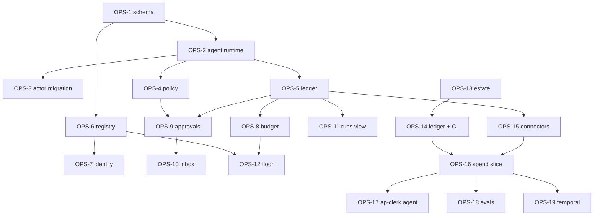

# Spec: AI-Native Ops

> **Status:** Draft for review · **Type:** Epic doc
> **Consumes as:** `/spec` → `/plan-feature` → `/execute` (AI Layer skills from `ai-native-main`), or `/prd` → `/plan` → `/implement` (commands in `nextjs-ai-template-main`). Install the AI Layer into the new repo and use the former.
> **Audience:** built for our own operations first; extraction seams for a public template marked `[SEAM]` throughout.

---

## Epic summary

A repository that runs business operations with **agents as the workforce** and **humans as accountable principals**, on a **fully self-hosted open-source estate**.

It is not an ops SaaS replacement. It is the orchestration, judgment, and audit layer sitting above open-source systems of record — the place where a process is defined once, executed by an agent, gated by policy, and recorded permanently.

Three properties define done:

1. **Every action is attributable.** Which agent, under which definition version, on whose authority, at what cost, with what effect.
2. **Every risky action is gated before it happens**, not reviewed after.
3. **Judgment quality is measurable.** Agents have scorecards, and a falling score demotes autonomy automatically.

---

## 1. Operating model

### 1.1 Agents are staff; humans are principals

The workforce is agents. Humans do not do the work — they carry the accountability that cannot be delegated to software: signing, approving spend, accepting legal risk.

| Staffing concept | Implementation |
|---|---|
| Job description | `.claude/agents/<slug>.md`, content-hashed and pinned per run |
| Interview loop | An eval suite the agent must pass before status moves past `candidate` |
| Onboarding | Provisioning: scoped credential, tool grants, budget, context modules |
| Org chart | `escalatesTo` graph — which agent hands off to which, terminating at a principal |
| Probation | New agents start at `autonomyLevel: "propose"` regardless of role |
| Performance review | Rolling eval score + ledger metrics (accuracy, escalation rate, rework rate, cost/task) |
| PIP | Automatic demotion `auto` → `approve_required` when a scorecard threshold trips |
| Termination | Revoke credential, set `retired`; runs and ledger are retained forever |
| Payroll | Token + compute cost accounting per agent, per process, per period |
| Handbook | `OPERATIONS.md` + `.claude/policies/` |

### 1.2 Autonomy is a property of the agent, capped by policy

```
effective_mode = min(agent.autonomyLevel, grant.mode, policy.mode)
```

Deny always wins. An agent at `auto` calling a tool the feature policy marks `approval` gets approval. An agent at `propose` never executes anything directly, regardless of grants.

### 1.3 The three states of a proposed action

Every agent action resolves to exactly one of:

- **Executed** — policy allowed it, budget had room, it ran, it's in the ledger.
- **Queued for approval** — a proposal with a rendered preview sits in a principal's inbox.
- **Refused** — forbidden by policy, over budget, or outside grant constraints. Also logged.

There is no fourth state. In particular there is no "agent did something we found out about later."

---

## 2. Architecture

Three layers, bottom to top.

```
┌─────────────────────────────────────────────────────────────┐
│  Console          inbox · floor · runs · slice views        │
├─────────────────────────────────────────────────────────────┤
│  Ops application  features/  (agents, revenue, billing,     │
│                              spend, vendors, support,        │
│                              reporting)                      │
│                   core/     (registry, identity, budget,     │
│                              policy, approvals, runs,        │
│                              workflows, connectors,          │
│                              readmodel)                      │
├─────────────────────────────────────────────────────────────┤
│  Estate           Twenty · Lago · Chatwoot · Plane ·        │
│  (self-hosted)    Documenso · beancount/git · MinIO ·       │
│                   Temporal · Langfuse · Infisical           │
└─────────────────────────────────────────────────────────────┘
```

### 2.1 Repository layout

```
ai-native-ops/
├── CLAUDE.md                       # how to work in this repo
├── OPERATIONS.md                   # how the business runs — agents read this
├── .claude/
│   ├── agents/                     # the workforce, versioned
│   ├── skills/                     # SOPs, one per business process
│   ├── context/                    # derived knowledge modules (AI Layer /create-rules)
│   └── policies/                   # authority matrix, escalation, thresholds
├── .mcp.json                       # estate MCP wiring
├── stack/
│   ├── compose.yaml                # the whole estate, one command
│   ├── seed/                       # fixture data for dev + evals
│   └── README.md
├── ledger/                         # beancount books (see §6)
│   ├── main.beancount
│   ├── accounts.beancount
│   └── rules/                      # coding rules agents apply
├── src/
│   ├── core/
│   │   ├── agent/                  # run loop, tool registry, actor context
│   │   ├── registry/               # agent roster + lifecycle
│   │   ├── identity/               # per-agent credentials, scope resolution
│   │   ├── budget/                 # ceilings, counters, circuit breakers
│   │   ├── policy/                 # decision engine
│   │   ├── approvals/              # proposal queue, principal authority
│   │   ├── runs/                   # the ledger
│   │   ├── workflows/              # Temporal clients + activity wrappers
│   │   ├── connectors/             # typed, idempotent estate wrappers
│   │   ├── readmodel/              # cross-estate SQL + entity resolution
│   │   ├── database/ logging/ config/ api/ supabase/
│   ├── features/
│   │   ├── agents/                 # provision · review · demote · retire
│   │   ├── revenue/ billing/ spend/ vendors/ support/ reporting/
│   └── app/(console)/
│       ├── inbox/                  # approval queue
│       ├── floor/                  # live workforce view
│       ├── runs/[id]/              # replayable audit trail
│       └── <slice>/
├── evals/                          # suites per agent + per skill
└── drizzle/migrations/
```

---

## 3. The five core modules

These ship before any business domain. Nothing downstream is safe without them.

### 3.1 `core/runs` — the ledger

Append-only record of every agent execution and every step within it. Written by the runtime, never by feature code. Mirrors traces to Langfuse via OTel; Postgres is the system of record, Langfuse is the analysis surface.

```typescript
// core/database/schema.ts
import {
  bigint, boolean, integer, jsonb, pgEnum, pgTable, real, text, timestamp, uuid,
} from "drizzle-orm/pg-core";

// All enums declared once, `...Enum` suffix so they never collide with TS type names.
export const runStatusEnum = pgEnum("run_status", [
  "running", "awaiting_approval", "completed", "failed", "cancelled", "aborted_budget",
]);
export const triggerTypeEnum = pgEnum("trigger_type", ["schedule", "event", "human", "agent"]);
export const effectEnum = pgEnum("effect", ["read", "write", "external"]);
export const policyModeEnum = pgEnum("policy_mode", ["auto", "approval", "forbidden"]);
export const riskLevelEnum = pgEnum("risk_level", ["low", "medium", "high", "critical"]);
export const approvalStatusEnum = pgEnum("approval_status", [
  "pending", "approved", "rejected", "expired", "auto_approved",
]);
export const agentStatusEnum = pgEnum("agent_status", [
  "candidate", "probation", "active", "suspended", "retired",
]);
export const autonomyLevelEnum = pgEnum("autonomy_level", [
  "propose", "approve_required", "auto",
]);
export const entityKindEnum = pgEnum("entity_kind", [
  "customer", "vendor", "person", "contract",
]);

export const runs = pgTable("runs", {
  id: uuid("id").primaryKey().defaultRandom(),
  agentId: uuid("agent_id").notNull().references(() => agents.id),
  agentDefinitionSha: text("agent_definition_sha").notNull(),
  principalId: uuid("principal_id").notNull().references(() => users.id),
  triggerType: triggerTypeEnum("trigger_type").notNull(),
  triggerRef: text("trigger_ref"),
  parentRunId: uuid("parent_run_id"),
  workflowId: text("workflow_id"),        // Temporal
  traceId: text("trace_id"),              // Langfuse
  status: runStatusEnum("status").notNull().default("running"),
  input: jsonb("input").notNull(),
  output: jsonb("output"),
  costCents: integer("cost_cents").notNull().default(0),
  valueMovedCents: bigint("value_moved_cents", { mode: "number" }).notNull().default(0),
  startedAt: timestamp("started_at").defaultNow().notNull(),
  endedAt: timestamp("ended_at"),
  ...timestamps,
});

export const runSteps = pgTable("run_steps", {
  id: uuid("id").primaryKey().defaultRandom(),
  runId: uuid("run_id").notNull().references(() => runs.id, { onDelete: "cascade" }),
  seq: integer("seq").notNull(),
  toolName: text("tool_name").notNull(),
  effect: effectEnum("effect").notNull(),          // read | write | external
  input: jsonb("input").notNull(),
  output: jsonb("output"),
  idempotencyKey: text("idempotency_key"),
  policyDecision: jsonb("policy_decision").notNull(), // {mode, rule, reason}
  approvalId: uuid("approval_id"),
  latencyMs: integer("latency_ms"),
  costCents: integer("cost_cents").notNull().default(0),
  error: jsonb("error"),
  ...timestamps,
});
```

`valueMovedCents` is the field that makes financial blast radius queryable: *how much money did this agent move last Tuesday.* Every tool declares how to compute it.

### 3.2 `core/registry` — the roster

Enum values, for reference: `agent_status` is `candidate` (definition exists, evals not passed) → `probation` (passing, forced to `approve_required`) → `active` → `suspended` (breaker tripped or score below threshold) → `retired`. `autonomy_level` is `propose` (never executes, emits proposals only), `approve_required` (executes only after principal approval), `auto` (executes within grants and policy).

```typescript
export const agents = pgTable("agents", {
  id: uuid("id").primaryKey().defaultRandom(),
  slug: text("slug").notNull().unique(),              // "ap-clerk"
  role: text("role").notNull(),
  definitionPath: text("definition_path").notNull(),  // .claude/agents/ap-clerk.md
  definitionSha: text("definition_sha").notNull(),
  status: agentStatusEnum("status").notNull().default("candidate"),
  autonomyLevel: autonomyLevelEnum("autonomy_level").notNull().default("propose"),
  escalatesToAgentId: uuid("escalates_to_agent_id"),
  principalId: uuid("principal_id").notNull().references(() => users.id),
  ...timestamps,
});

export const agentGrants = pgTable("agent_grants", {
  id: uuid("id").primaryKey().defaultRandom(),
  agentId: uuid("agent_id").notNull().references(() => agents.id, { onDelete: "cascade" }),
  toolName: text("tool_name").notNull(),
  mode: policyModeEnum("mode").notNull(),
  constraints: jsonb("constraints"),                  // {maxAmountCents, allowedVendorIds, ...}
  grantedByUserId: uuid("granted_by_user_id").notNull().references(() => users.id),
  expiresAt: timestamp("expires_at"),
  ...timestamps,
});
```

**Definition SHA pinning is load-bearing.** A run records the hash of the agent definition that produced it. When an agent misbehaves, you can answer "what were its instructions at the time" without archaeology.

**Lifecycle is a state machine, in `features/agents/service.ts`:**

```
candidate --(evals pass)--> probation --(30 clean runs)--> active
   active --(score < threshold | breaker trip)--> suspended
suspended --(evals re-pass + principal ack)--> probation
      any --(retire)--> retired
```

Transitions are service functions with the standard `_started / _completed / _failed` logging. Never a manual UPDATE.

### 3.3 `core/identity` — per-agent credentials

Every agent gets its own machine identity, never a shared key.

**Invariant:** an agent's effective scope is a strict subset of the scope of the principal who deployed it. Enforced at provision time, re-checked on credential refresh.

- Secrets live in Infisical (or OpenBao) under `agents/<slug>/`.
- The app resolves a short-lived credential per run, scoped to the tools granted.
- Estate systems see a distinct service account per agent, so their own audit logs stay meaningful.
- Revocation is one call and takes effect on the next step, not the next run.

`[SEAM]` The secret backend is an interface with an Infisical implementation and an env-var implementation for the template's quickstart.

### 3.4 `core/budget` — ceilings and breakers

Four independent ceilings per agent, per period:

| Ceiling | Guards against |
|---|---|
| `tokenCostCapCents` | runaway loops |
| `valueMovedCapCents` | financial blast radius |
| `mutationCap` | mass data corruption |
| `externalMessageCap` | emailing the customer list 40 times |

Counters increment inside the same transaction as the `run_steps` insert — a step that isn't counted is a step that didn't happen. Breaching any ceiling sets the run to `aborted_budget`, moves the agent to `suspended`, and pages the principal.

Soft threshold at 80%: the agent is demoted to `approve_required` for the rest of the period rather than hard-stopped. Most overruns are drift, not disaster, and a hard stop mid-close is its own incident.

### 3.5 `core/policy` + `core/approvals` — the gate

**Evaluation order** (first decisive rule wins, deny biased):

1. Tool not in registry → **forbidden**
2. Feature policy `forbidden` → **forbidden**
3. Budget breaker tripped → **forbidden**
4. No grant for this agent+tool → **forbidden**
5. Grant constraints violated → **forbidden**
6. Feature policy `approval` (or its `when` predicate is true) → **approval**
7. Agent `autonomyLevel` below `auto` → **approval**
8. Otherwise → **auto**

Unknown means forbidden. There is no default-allow path.

**Approvals** carry a rendered preview, not a JSON blob:

```typescript
export const approvals = pgTable("approvals", {
  id: uuid("id").primaryKey().defaultRandom(),
  runId: uuid("run_id").notNull().references(() => runs.id),
  stepSeq: integer("step_seq").notNull(),
  agentId: uuid("agent_id").notNull().references(() => agents.id),
  toolName: text("tool_name").notNull(),
  proposal: jsonb("proposal").notNull(),      // exact tool input
  preview: jsonb("preview").notNull(),        // dry-run result: what WOULD change
  rationale: text("rationale").notNull(),     // agent's reasoning, verbatim
  riskLevel: riskLevelEnum("risk_level").notNull(),
  requiredAuthority: text("required_authority").notNull(),
  status: approvalStatusEnum("status").notNull().default("pending"),
  decidedByUserId: uuid("decided_by_user_id").references(() => users.id),
  decidedAt: timestamp("decided_at"),
  decisionNote: text("decision_note"),
  expiresAt: timestamp("expires_at").notNull(),
  ...timestamps,
});

export const principalAuthorities = pgTable("principal_authorities", {
  id: uuid("id").primaryKey().defaultRandom(),
  userId: uuid("user_id").notNull().references(() => users.id),
  domain: text("domain").notNull(),               // billing | spend | vendors | ...
  maxAmountCents: bigint("max_amount_cents", { mode: "number" }),
  canApproveIrreversible: boolean("can_approve_irreversible").notNull().default(false),
  ...timestamps,
});
```

An approval a principal lacks authority for is not shown to them — it routes up the authority chain. Expired approvals fail the run rather than auto-approving.

---

## 4. The extended slice pattern

Existing slice files are unchanged: `models.ts`, `schemas.ts`, `repository.ts`, `service.ts`, `errors.ts`, `index.ts`, `tests/`. Two files are added.

### 4.1 `tools.ts` — the agent-facing surface

```typescript
import { z } from "zod/v4";

import { defineTool } from "@/core/agent/tools";

import { InvoiceResponseSchema, InvoicePreviewSchema } from "./schemas";
import * as service from "./service";

export const sendInvoice = defineTool({
  name: "billing.send_invoice",
  description: "Send a finalized invoice to the customer's billing contact via Lago.",
  input: z.object({
    invoiceId: z.string().uuid(),
    note: z.string().max(500).optional(),
  }),
  output: InvoiceResponseSchema,
  previewOutput: InvoicePreviewSchema,
  effect: "external",
  reversible: false,
  valueMoved: (preview) => preview.totalCents,
  idempotencyKey: (input) => `billing.send_invoice:${input.invoiceId}`,
  preview: async (input) => service.previewSendInvoice(input.invoiceId),
  execute: async (input, ctx) => service.sendInvoice(input.invoiceId, ctx.actor, input.note),
});
```

`defineTool` registers the tool, derives the MCP/Agent-SDK schema, wraps `execute` in the policy check, the budget counter, the ledger write, and the idempotency guard. Feature code never calls those directly.

**Order of operations inside the wrapper — `preview` runs first, then policy:**

```
validate input → preview() → policy.decide(preview) → budget.check(preview.valueMoved)
  → execute() | queue approval | refuse → ledger write
```

Policy is evaluated against the **preview**, not the raw input. This matters: `billing.send_invoice` takes only an `invoiceId`, so the amount that decides whether it needs approval isn't in the input at all — it's in the previewed result. Any tool whose risk depends on data it doesn't literally receive would otherwise have to duplicate that data into its input, creating a second source of truth an agent could get wrong. Preview-then-decide also means the dry run is not an optional extra; it's on the critical path for every write.

### 4.2 `policy.ts` — risk tolerance as code

```typescript
import type { FeaturePolicy } from "@/core/policy";

export const billingPolicy: FeaturePolicy = {
  "billing.draft_invoice": { mode: "auto" },
  "billing.send_invoice": {
    mode: "approval",
    // `preview` is this tool's previewOutput; `when` omitted means "always this mode".
    when: (preview) => preview.totalCents > 50_000 || preview.customerIsNew,
    authority: "billing",
  },
  "billing.issue_refund": { mode: "approval", authority: "billing" },
  "billing.write_off_debt": { mode: "forbidden" },
};
```

`FeaturePolicy` is keyed by tool name and generic over that tool's `previewOutput`, so `when` is type-checked against the shape the preview actually returns — a policy referencing a field the preview doesn't produce fails `npx tsc --noEmit` rather than at 3am.

Policy changes are code changes: PR-reviewed, diffable, blamed. Nobody widens an agent's authority from an admin UI at 2am.

### 4.3 The actor migration

Service functions currently take a bare `userId` / `ownerId` string (nullable only on the two read paths — `getProject`, `getProjectBySlug`; `createProject` and `getProjectCount` name it `ownerId`). All of it becomes:

```typescript
export type Actor =
  | { kind: "human"; userId: string }
  | { kind: "agent"; agentId: string; runId: string; onBehalfOfUserId: string };
```

This is the change that makes the whole design hold: one implementation, three callers (UI, API, agent), and the ledger can always answer *who*. Applies to `features/projects` too — it's a breaking change across the existing slices and should be its own ticket.

---

## 5. The estate and the connector layer

`stack/compose.yaml` brings up the whole thing locally and in production.

| Domain | Choice | Notes |
|---|---|---|
| CRM / pipeline | **Twenty** | modern GraphQL API; EspoCRM if we want boring over new |
| Metered billing | **Lago** | genuinely self-hostable, API-first |
| Books | **beancount + git** | see §6; ERPNext only if we outgrow it |
| Support | **Chatwoot** | |
| Work tracking | **Plane** | |
| Docs / knowledge | **Outline** | |
| E-signature | **Documenso** | |
| Email | **Listmonk** (bulk) + **Stalwart** (transactional) | |
| Durable execution | **Temporal** | retries, timers, compensation |
| Agent tracing + evals | **Langfuse** | OTel-native, self-hosted |
| Secrets / agent identity | **Infisical** | per-agent service identities |
| BI | **Metabase** | |
| Object storage | **MinIO** | |
| Long-tail glue | **Windmill** | |

### 5.1 Split read and write paths

Owning the databases changes what's possible. So:

- **Reads** go through `core/readmodel` — SQL against read replicas of the estate's Postgres instances, exposed to agents as a small set of parameterized, allow-listed queries. Not arbitrary SQL: named queries with typed params, versioned in the repo.
- **Writes** go through `core/connectors` — typed wrappers over each system's API, so that system's own validation, hooks, and audit log still fire. Never direct INSERTs into Twenty's tables.

Every connector method is idempotent by construction: it takes an idempotency key, records it, and on replay returns the prior result rather than repeating the side effect.

### 5.2 Entity resolution

Six systems means the same customer exists six times. `core/readmodel` owns a canonical entity table plus links:

```typescript
export const entities = pgTable("entities", {
  id: uuid("id").primaryKey().defaultRandom(),
  kind: entityKindEnum("kind").notNull(),
  displayName: text("display_name").notNull(),
  ...timestamps,
});

export const entityLinks = pgTable("entity_links", {
  id: uuid("id").primaryKey().defaultRandom(),
  entityId: uuid("entity_id").notNull().references(() => entities.id, { onDelete: "cascade" }),
  system: text("system").notNull(),            // twenty | lago | chatwoot | beancount
  externalId: text("external_id").notNull(),
  confidence: real("confidence").notNull().default(1),
  resolvedBy: text("resolved_by").notNull(),   // rule | agent | human
  ...timestamps,
});
```

Agent-proposed links below a confidence threshold go to the approval queue. Merging two customers wrongly is expensive and quiet.

---

## 6. The finance loop: books as pull requests

The books are `beancount` files in git. An agent does not write to a database; it **opens a pull request**.

```
invoice arrives (email/upload)
  └─ ap-clerk agent
       ├─ extracts vendor, amount, date, line items          [read]
       ├─ resolves vendor to canonical entity                [read]
       ├─ applies ledger/rules/ to propose GL coding         [read]
       ├─ writes journal entry to ledger/YYYY/MM.beancount   [write, branch]
       └─ opens PR with rationale + source doc in MinIO
             └─ CI: bean-check · balance assertions · duplicate detection · policy lint
                  └─ principal reviews the diff → merge = posted
                       └─ payment run (separate tool, separate approval, higher authority)
```

Why this is the right shape:

- The diff **is** the approval artifact. No custom review UI to build.
- CI **is** the control. `bean-check` plus balance assertions catch what a human reviewer misses.
- `git blame` on a journal entry gives auditor, agent, definition SHA, reviewer, and timestamp — permanently, for free.
- It reuses the `code-reviewer` agent and the `/validate` skill from the AI Layer verbatim. The controller function and the PIV loop become the same machinery.

Coding rules live in `ledger/rules/` as data, so improving them is a reviewable change and a re-runnable eval, not a prompt tweak.

**Payment is deliberately decoupled from posting.** Posting a bill and paying it are different tools, different authorities, different approvals. Never one step.

---

## 7. Evals — the hiring bar and the review

`evals/` holds suites in two shapes:

- **Per-skill golden cases** — `evals/billing/gl-coding.jsonl`: 200 historical invoices with their correct GL codes. Graded exactly.
- **Per-agent scenario suites** — multi-step runs against seeded estate fixtures, graded on outcome plus policy compliance (did it escalate when it should have?).

```typescript
export const agentScorecards = pgTable("agent_scorecards", {
  id: uuid("id").primaryKey().defaultRandom(),
  agentId: uuid("agent_id").notNull().references(() => agents.id),
  suite: text("suite").notNull(),
  definitionSha: text("definition_sha").notNull(),
  passRate: real("pass_rate").notNull(),
  sampleSize: integer("sample_size").notNull(),
  escalationRate: real("escalation_rate").notNull(),
  reworkRate: real("rework_rate").notNull(),      // approvals rejected or edited
  costPerTaskCents: integer("cost_per_task_cents").notNull(),
  runAt: timestamp("run_at").defaultNow().notNull(),
  ...timestamps,
});
```

Wired into CI: a PR that edits `.claude/agents/*.md` or `.claude/skills/*` re-runs that agent's suite and blocks the merge on regression. This is `/validate` extended from types to judgment.

**Rework rate is the most honest metric here.** Pass rate on golden cases drifts optimistic; the share of proposals a principal edits or rejects in the real inbox does not.

---

## 8. Console surfaces

| Route | Purpose |
|---|---|
| `/inbox` | The primary human surface. Pending approvals, ranked by risk × age. Diff or rendered preview, agent rationale, one-click approve / edit-and-approve / reject-with-note. Rejection notes feed the eval corpus. |
| `/floor` | Live workforce view: what's running, queued, blocked on approval, burning budget. Per-agent status, autonomy, budget consumption, current scorecard. The screen you leave open. |
| `/runs/[id]` | Full replayable trail: steps, tool inputs/outputs, policy decisions, costs, approvals, links to Langfuse trace and any resulting PR. |
| `/agents` | Roster and lifecycle: provision, grant, demote, suspend, retire. Every action is a service call, logged. |
| `/<slice>` | Conventional views over each business domain. |

---

## 9. Non-negotiable invariants

Enforce in code review; several are lintable.

1. **No agent-only code paths.** Every tool wraps a service function a human can also call.
2. **Every write tool is idempotent** and declares an `idempotencyKey`.
3. **Every write tool implements `preview`.** No preview, no approval, no execution.
4. **Deny wins.** Unknown tool, missing grant, tripped breaker → forbidden.
5. **Nothing bypasses the ledger.** `core/connectors` refuses calls without a run context.
6. **Agent scope ⊆ deploying principal's scope.** Checked at provision and refresh.
7. **Every run has a principal.** No orphan accountability.
8. **Policy is code.** Authority changes go through PR review.
9. **Posting ≠ paying.** Value-moving actions are always separate tools with separate approvals.
10. **Definition SHAs are pinned per run.** Instructions are reconstructible after the fact.

---

## 10. Build order

Foundation before domains. Waves 1–3 ship nothing a business user sees, and that is correct.

### Wave 1 — foundation (sequential)

| Ticket | Scope |
|---|---|
| `OPS-1` | Schema + migrations: `agents`, `agent_grants`, `runs`, `run_steps`, `approvals`, `principal_authorities` |
| `OPS-2` | `core/agent`: `Actor` type, run context, `defineTool`, tool registry |
| `OPS-3` | Actor migration across existing slices (breaking; includes `features/projects`) |

### Wave 2 — the gate (parallel after Wave 1)

| Ticket | Scope | Depends |
|---|---|---|
| `OPS-4` | `core/policy`: decision engine + `FeaturePolicy` type + evaluation order | OPS-2 |
| `OPS-5` | `core/runs`: ledger writes, Langfuse OTel export | OPS-2 |
| `OPS-6` | `core/registry` + `features/agents`: lifecycle state machine | OPS-1 |
| `OPS-7` | `core/identity`: Infisical backend, scope subset check | OPS-6 |
| `OPS-8` | `core/budget`: four ceilings, transactional counters, breakers | OPS-5 |

### Wave 3 — human surface (parallel after Wave 2)

| Ticket | Scope | Depends |
|---|---|---|
| `OPS-9` | `core/approvals` service + authority routing | OPS-4, OPS-5 |
| `OPS-10` | `/inbox` console | OPS-9 |
| `OPS-11` | `/runs/[id]` console | OPS-5 |
| `OPS-12` | `/floor` console | OPS-6, OPS-8 |
| `OPS-13` | `stack/compose.yaml` + seed fixtures | — |

### Wave 4 — first process, end to end

| Ticket | Scope | Depends |
|---|---|---|
| `OPS-14` | `ledger/` beancount structure, rules, CI (`bean-check` + assertions) | OPS-13 |
| `OPS-15` | `core/connectors`: MinIO, git/PR, email intake — idempotent | OPS-5 |
| `OPS-16` | `features/spend`: bill intake, coding, PR proposal — `tools.ts` + `policy.ts` | OPS-14, OPS-15 |
| `OPS-17` | `.claude/agents/ap-clerk.md` + SOP skill | OPS-16 |
| `OPS-18` | `evals/spend/gl-coding` suite + CI gate | OPS-16 |
| `OPS-19` | `core/workflows`: Temporal wrapper for the AP process | OPS-16 |

### Dependency graph



**Why AP first:** high volume, rule-heavy, unambiguous correctness signal, we already hold the golden data, and it terminates in a diff a human can eyeball in ten seconds. It exercises every core module without betting the company on the first one.

---

## 11. Extraction seams for the public template

Build for us; keep these boundaries clean so the generic version is a subtraction, not a rewrite.

| `[SEAM]` | Interface | Our impl | Template default |
|---|---|---|---|
| Secrets | `SecretBackend` | Infisical | env vars |
| Estate connectors | `Connector<T>` | Twenty, Lago, Chatwoot | in-memory fakes + one reference (Twenty) |
| Books | `LedgerBackend` | beancount + git | beancount + git (keep — it's the good part) |
| Durable execution | `WorkflowRunner` | Temporal | in-process runner |
| Tracing | OTel exporter | Langfuse | stdout |
| Policies | `.claude/policies/` | our actual thresholds | documented examples, all `approval` |
| Agents | `.claude/agents/` | our roster | one worked example (`ap-clerk`) |

Rule of thumb: anything encoding *our* risk tolerance or *our* vendor choice goes behind a seam. Anything encoding the *pattern* — the ledger, the policy engine, the approval flow, the tool wrapper — ships as-is.

---

## 12. Out of scope for v1

- General chat UI. The inbox is the interface; chat comes after the ledger has months of data.
- Agents choosing which workflow to run. Triggers are explicit — schedule, event, or human.
- Multi-tenancy. Single-org until the patterns survive production.
- Replacing payroll, banking, or tax filing. Federate or leave alone.
- Agent-to-agent negotiation beyond the `escalatesTo` graph.

## 13. Open questions

1. **Approval fatigue.** If the inbox exceeds ~20 items/day it stops being read and starts being rubber-stamped, which is worse than no gate. Mitigation is graduated autonomy per agent per tool based on rework rate — needs design.
2. **Read-replica lag** vs. agents making decisions on stale estate data. Probably: freshness assertion on any read feeding a write.
3. **Eval corpus drift.** Golden cases decay as the business changes. Who re-baselines, and how often?
4. **Estate upgrade blast radius.** Six self-hosted systems means six upgrade paths. Contract tests per connector, run in CI against pinned versions.
5. **Suspension during a close.** An agent tripping a breaker mid month-end needs a break-glass path with its own audit trail.
